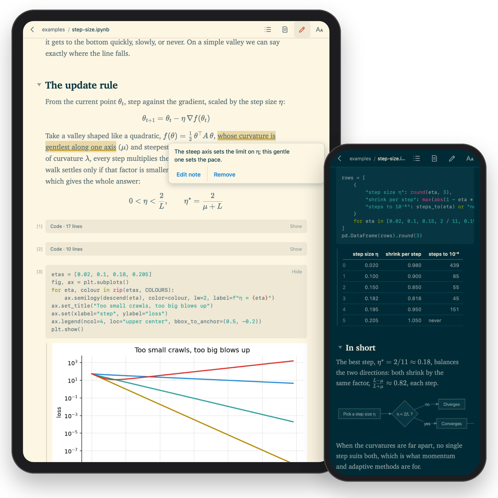

# lectern

Read your Jupyter notebooks and markdown on a tablet, a phone or an e-ink reader, and publish them as a website.

<p align="center">
  
</p>

## Why I made it

I write a lot of Jupyter notebooks, and I wanted two things that nothing quite gave me. The first was a better way to share them than GitHub's notebook view, which often fails to show a notebook properly: formulas that do not render, outputs that are missing, and large notebooks that do not open at all. The second was to read my notebooks and markdown away from the desk, on a tablet, and to mark them up as I read, the way I would a paper.

Lectern does both. It turns notebooks and markdown into clean, readable pages. It serves them from your computer to the devices on your home network, or publishes them as a static website. It never runs code, so there is no kernel, no token and no password: you open an address and read.

## Features

**Notebooks and markdown, made for reading**
- Jupyter notebooks and markdown files become clean pages: prose in a comfortable column, code without the clutter, and the outputs you saved.
- Formulas are typeset, plots and pictures are shown, mermaid diagrams are drawn in your theme's colours, and tables wrap to fit the screen.
- Links between your notebooks and documents just work.
- The important part comes first. Long code and long printed output start folded, and one tap opens them. You decide which cells stay shown or hidden, or hide the code altogether and read the notebook as an article.

**Find your way around**
- A library of everything in the folder, with titles, opening lines and reading time, or a plain file view.
- A contents list for each document. Fold any section, or collapse the whole document to its outline.
- Back and forward between documents, landing where you were. Reopen a document and you are where you stopped.
- Find in the page, even in the full-screen app, opening folded parts where the matches are.

**Make it yours** (remembered on each device)
- Text size, and column width from narrow to the full screen.
- Solarized or black-and-white colours, light or dark, or following the system.
- Sensible starting sizes for a tablet, a phone, a desktop or an e-ink reader.

**At home on e-ink**
- Chosen by itself on e-ink readers: crisp black on white, with nothing animated.
- Turn pages instead of scrolling, with buttons, a tap on either edge, or the page keys. Every page starts and ends on a whole line and repeats the last two lines of the page before, so you never lose your place.
- On colour e-ink, code and output can be in colour. Pictures always are.
- Tap the page number to hide the top bar and use the whole screen.

**Highlights and notes**
- Turn on the pen, select a passage, and it is highlighted. Tap it to write a note.
- Marks are kept on your computer beside the document, so they are the same on every device, and you can commit them with the repository.
- `lectern notes` prints everything you marked as markdown, ready for your own notes.

**Like an app on your tablet**
- Add it to the Home Screen: full screen, no browser bars, and it reopens on the page you were reading.
- It always shows the latest save, uncommitted work included, and it can reload by itself when you save.
- Serve the folders you read often from one address, start it at login, and reach it away from home over Tailscale.

**Publish as a website**
- The same pages as a static site for GitHub Pages or any host, with the same themes, settings and e-ink support for your readers.

## How it compares

Before writing lectern I looked for a tool that would let me browse a folder, tap a notebook and get a page that reads well on a tablet. I did not find one that was maintained:

- **JupyterLab and Jupyter Notebook** are editors that run code, so every device needs a token or password. On a touch screen, scrolling selects cells and menus close under the finger.
- **VS Code in the browser** (a tunnel, vscode.dev or code-server) is an editor too, and on an iPad its notebooks do not scroll by touch.
- **GitHub's notebook view** shows only what is committed and pushed, often fails to open a notebook at all, and has nowhere to keep your notes.
- **nbviewer** shows a notebook from a URL or a GitHub repository. It is a service for sharing, not a reader for the folder on your computer.
- **Quarto and Jupyter Book** build polished websites and books from a project set up for them, and are the better choice for a book. They are publishing tools rather than a reader for the folder you are working in.
- **Voilà** turns a notebook into a dashboard by running it with a fresh kernel, instead of showing the outputs you saved.

Lectern is a reader, not an editor. Because it never runs code, it needs no token or password. It shows the folder you are working in as you last saved it, set for a tablet, a phone or an e-ink screen, and it keeps your highlights and notes. The same pages publish as a website.

## Install

You need Python 3.12 or newer and [uv](https://docs.astral.sh/uv/).

```sh
uv tool install git+https://github.com/anton-dergunov/lectern
```

Lectern is developed on macOS and should run anywhere Python does. Starting it at login is macOS-only ([details](docs/guide.md#install)).

## Publish your notebooks as a website

In a repository of notebooks:

```sh
lectern build . -o _site
```

`_site` now holds a page for every notebook and an index of them, ready for any static host. Markdown files are included only when a notebook links to them, so your README and working notes stay private unless you ask. A few lines in a GitHub Actions workflow publish the site on GitHub Pages on every push.

[Agent memory, call by call](https://anton-dergunov.github.io/agent-memory-eval/) is a site made this way.

More: [Publishing as a website](docs/guide.md#publishing-as-a-website), with the workflow and the `lectern.toml` settings.

## Read on a tablet

In the folder you want to read:

```sh
lectern serve
```

Open the address it prints (`http://your-desktop.local:8642/`) on your tablet, phone or e-ink reader. On an iPad, Share → Add to Home Screen makes it a full-screen app. Turn on the pen in the top bar to highlight and make notes.

Lectern runs no code and changes nothing on your computer but the notes you make. But anyone on the same network can read what you serve, so use it on a network you trust.

More, in the guide:
- [Always on](docs/guide.md#always-on-macos): serve the folders you read often, from login onwards.
- [Away from home, and full screen on Android](docs/guide.md#away-from-home-and-full-screen-on-android), with Tailscale.
- [Keeping files out of sight](docs/guide.md#keeping-files-out-of-sight), and [what it hands out](docs/guide.md#what-it-hands-out-and-who-can-see-it).

## Try it

The repository has a sample notebook, the one in the picture above:

```sh
git clone https://github.com/anton-dergunov/lectern
lectern serve lectern/examples
```

## More

- [docs/guide.md](docs/guide.md): everything lectern does and how to set it up.
- [docs/architecture.md](docs/architecture.md): how it is built, and how to work on it.

## License and credits

MIT, see [LICENSE](LICENSE). Colours are Ethan Schoonover's [Solarized](https://ethanschoonover.com/solarized/). Notebook conversion is [nbconvert](https://nbconvert.readthedocs.io/). Math is typeset by [KaTeX](https://katex.org/) (MIT), diagrams are drawn by [Mermaid](https://mermaid.js.org/) (MIT).

On devices without Apple's fonts the pages use [Charis SIL](https://software.sil.org/charis/), [JetBrains Mono](https://www.jetbrains.com/lp/mono/) and [Inter](https://rsms.me/inter/), each under the SIL Open Font License; the licences are in `src/lectern/static/fonts`.
